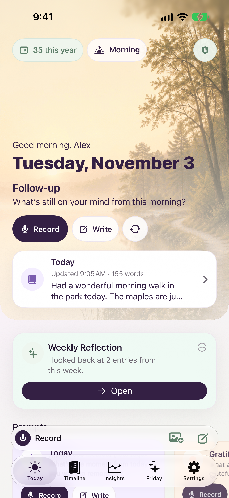
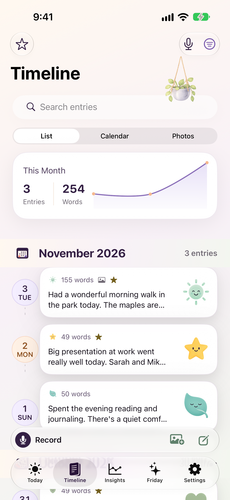
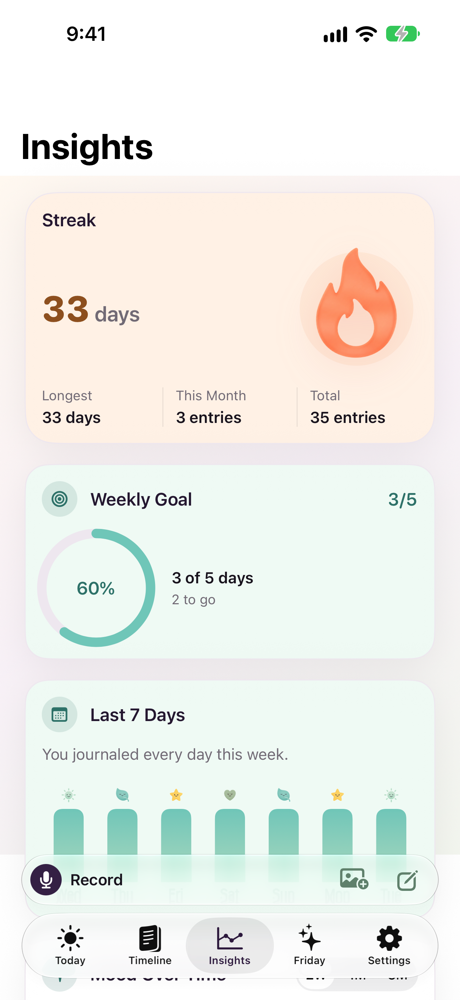
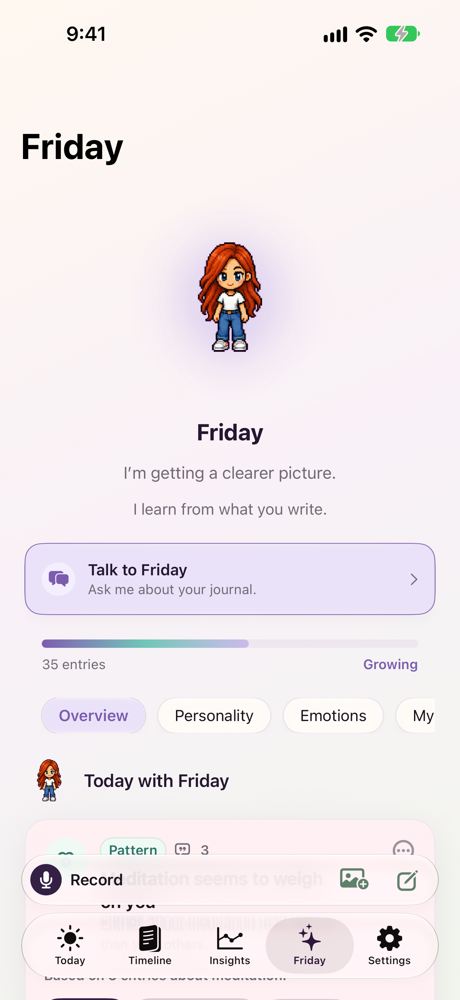
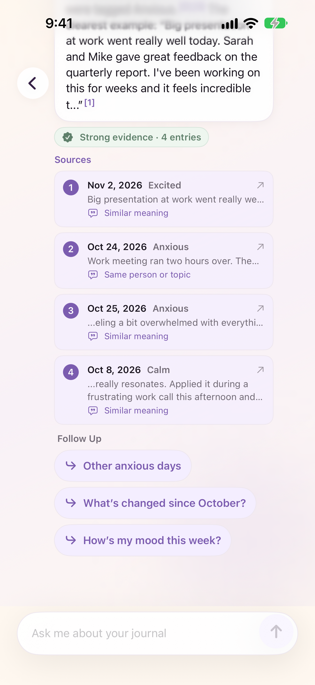
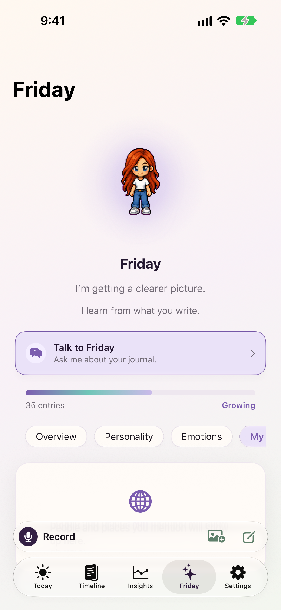
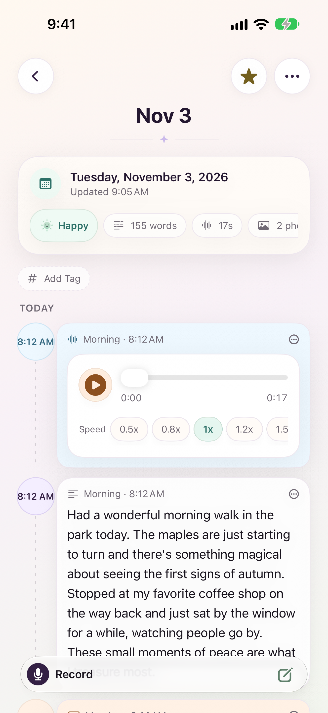
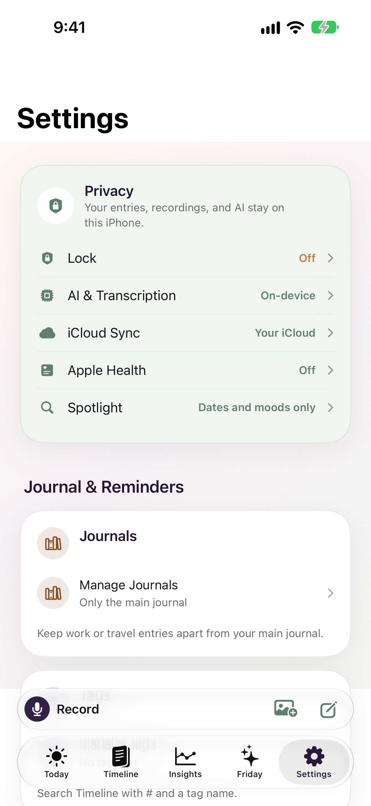

# OffRecord AI Journal — Free Voice Journal with Private AI for iPhone, iPad, Mac & Apple Watch

[%20%7C%20watchOS%2026%2B-lightgrey?style=for-the-badge&logo=apple)](https://apps.apple.com/app/id6766499684)

OffRecord AI Journal is a **free voice journal app** for iPhone, iPad, Mac, and Apple Watch that turns quick thoughts into a searchable, private diary. iPhone, iPad, and Mac hold the full journal; the Apple Watch companion is a fast capture and outbox surface for Mood, Speak, Record, and Recent. Journal text and the search index are stored on your device and are not sent to developer servers. No accounts, no developer servers, no data collection.

Speak naturally, and OffRecord transcribes on-device with Apple's SpeechAnalyzer after asking your permission. SpeechTranscriber provides the primary accuracy path, while DictationTranscriber expands locale coverage without using a speech server. Over time, **Friday** learns your patterns and the people and topics in your life, on your device. When Apple Intelligence is available, Friday also uses Apple's on-device language model (`SystemLanguageModel`) to hold a conversation, and she cites the entries she used. Search finds entries by meaning, and Weekly Reflection, Month in Review, and Year in Review give you a private look back.

**Your journal text, audio, transcripts, and search index stay on your device and are not sent to developer or speech-recognition servers. Apple Watch captures are stored on the watch first and transfer to the iPhone through Apple WatchConnectivity.**

[Download OffRecord AI Journal Free](https://apps.apple.com/app/id6766499684) | [Visit Website](https://saransh-sharma.github.io/Off-Record/) | [See Features](https://saransh-sharma.github.io/Off-Record/#features) | [Privacy](https://saransh-sharma.github.io/Off-Record/privacy.html) | [Support](https://saransh-sharma.github.io/Off-Record/support.html)

---

## Screenshots

  
  
  
  

  
  
  
  

---

## Features

### Voice Journaling That Works Offline
Record your thoughts and OffRecord transcribes them on-device using Apple SpeechAnalyzer after asking your permission. iOS may download a language model from Apple before first use. Unsupported languages keep the original recording and never fall back to server transcription.

### Mac App
OffRecord runs on the Mac through Mac Catalyst, with the same journal and the same iCloud container as iPhone and iPad. It opens with the tab sidebar showing and adds menu commands with shortcuts: Write (⌘N), Record (⇧⌘R), Search Entries (⌘F), and Settings (⌘,). Widgets, the Apple Watch app, Live Activities, Siri tips, Journaling Suggestions, and Apple Health are not part of the Mac app.

### Apple Watch Quick Capture
OffRecord includes a watchOS 26+ companion for fast capture when your phone is not in your hand. The watch app is intentionally not a full journal browser. It is a private capture surface with:

- **Mood**: Crown-first mood dial using the same eight OffRecord moods.
- **Speak**: quick dictation with a two-line preview when a transcript is available.
- **Record**: audio-first capture with pause/resume, timer, waveform feedback, and "Saved on watch first" behavior.
- **Recent**: the last 20 captures as an outbox/status view, not a journal archive.
- **Complication and Smart Stack**: privacy-safe quick launch and queue status only; no journal text appears on the watch face.

Captures save on the watch before sync. If the iPhone is unreachable, they remain in the watch outbox and retry later. Watch captures go to the main journal.

### Friday, Your Private AI Journal
**Friday** learns your communication style, emotional patterns, and life themes from your entries. Free-form questions retrieve evidence from your entries first, then answer with visible citations when the journal supports a claim. Friday runs on your iPhone, iPad, or Mac. There is no server-side AI for journal data and no developer API.

When Apple Intelligence is available on the device, Friday uses Apple's on-device model:

- **Chat across turns.** Friday keeps the conversation going and looks things up with three journal tools (search, mood counts, and people). She cites only entries those tools returned.
- **Generated titles.** Entries can get short titles, shown in the entry and on Timeline.
- **Go Deeper.** An entry can suggest one follow-up question written for that entry.
- **Weekly Reflection wording.** The model can rephrase the report's cover line and summary from the week's facts.

Every generated line is checked against OffRecord's voice and safety rules; if it fails, the app shows its deterministic wording instead. Without Apple Intelligence, Friday answers from summaries and says so once. OffRecord never uses Private Cloud Compute or a non-Apple model.

### People, Places, and Topics
Friday's My World tracks the people, places, and topics you mention. Each one opens a page with how many entries mention it, a chart by month, the mood of those entries, the first and last mention, and the entries themselves. You can rename or forget an item from its page. Entries kept out of Friday never count.

### Tags and Journals
- **Tags**: add tags to an entry, filter Timeline by tag, or search with `#` (for example `#work`). Settings › Tags renames, merges, and deletes tags.
- **Multiple journals**: keep separate journals, each with its own entry for the day. Pick the journal when you record or write, narrow Timeline to one journal, and export one journal as a PDF. Settings › Journals creates, renames, archives, and deletes journals; deleting one asks whether its entries move to the main journal or are deleted.

### Search by Meaning
Search your Timeline by meaning, not only exact words. Queries like "stress after work" or "people I miss" can surface related entries even when those exact words are not present, while exact names, places, moods, dates, and starred entries still rank highly.

### Weekly Reflection
Weekly Reflection turns your started entries into a calm ritual at the end of the week. When there is enough writing, OffRecord can show a Home card, generate a private report, and keep a history in Insights. Reports include a short cover line, summary, emotional arc, key themes, small wins, frictions, questions for next week, saved takeaways, and export options.

Reports are built on your device from compact entry snapshots: date, mood, word count, source type, sentiment, top topics, and short snippets. You can open sources, hide or re-include entries for a regenerated report version, dismiss a Home card without deleting history, delete a report, and export Markdown or plain text. Source quotes stay out of export unless you include them.

OffRecord treats high-risk entries carefully. They still count toward weekly eligibility and source management, but their text, snippets, topics, quotes, and evidence references are excluded from generated insights and exports.

### Month in Review and Year in Review
Month in Review appears on Insights, with history. Year in Review opens from December 1 for the current year and anytime for past years. It covers counts, Year in Pixels, mood by month, people and topics, and entries that mattered. Its share card replaces names with "someone" unless you turn names on.

### Session Prep
Session Prep summarizes a date range to bring to a session with a therapist or coach. You choose which quotes to include (none by default) and can add what you want to bring up. Names are replaced unless you turn them on. It exports as PDF, Markdown, or plain text.

### Import From Other Apps
Settings › Import reads exports from Day One (JSON ZIP), Apple Journal (the exported folder or its ZIP), Markdown or text files, and CSV. You see a preview before anything is saved. Same-day entries become one day's page, photos fill up to five per day, Day One and Markdown tags become OffRecord tags, and importing the same file again doesn't add duplicates. Files are read on your device.

### Journaling Suggestions (iPhone)
On iPhone, Today can open Apple's Journaling Suggestions picker. Picking a suggestion starts an entry with its prompt and attaches its photos, up to five. Only the suggestion you pick reaches OffRecord.

### Keep Out of Friday, the Friday Switch, and Erase All Data
- **Keep Out of Friday** (per entry): the entry is never indexed for search by meaning, cited, learned from, or quoted. Weekly Reflection still counts it unless you also choose **Skip Weekly Reflection**.
- **Friday switch**: turning Friday off in Settings deletes what she learned, her chat, and her generated titles and questions. Search by meaning and Weekly Reflection keep working.
- **Erase All Data**: deletes every entry, recording, photo, tag, journal, report, the search index, and Friday's data, and the app starts fresh. With iCloud Sync on, the deletion reaches iCloud too, and the confirmation says so.

### Mood Tracking & Sentiment Analysis
Automatic mood detection with trends across days, weeks, and months. Understand your emotional arc without manually tagging every entry.

### Insights
Patterns about your journaling habits, writing style, and emotional trends, computed on your device. Every insight has a "Why?" sheet that shows what it's based on.

### Streaks That Forgive a Rest Day
Daily streaks allow one rest day in any 7 days, so a single missed day doesn't reset the count. You can switch to weekly streaks instead. Widgets show the same number as the app.

### Biometric Security
Face ID and Touch ID lock keep your **private journal app** secure. No one can read your entries without your biometric authentication.

### Photo Attachments
Attach up to 5 photos per entry. Photos are stored in the app and sync only through your own iCloud when you turn on iCloud Sync.

### 8 Themes
System, Light, Sage, Lavender, Rose, Ocean, Warm, and Dark.

### Encrypted Exports
Export journal entries to PDF, JSON, Markdown, CSV, or an AES-256 encrypted backup. Backups keep Keep Out of Friday, tags, and journal membership. Weekly Reflection reports export to Markdown or plain text, with source quotes off by default.

### Optional iCloud Sync
Sync across your Apple devices through your personal iCloud account. Settings shows the last sync, whether it's syncing now, the last error in plain words, and whether you're signed in to iCloud. Turning sync on or off applies right away, with no relaunch. Recordings stay on the device that made them; an entry synced from another device says where its recording is.

If the journal can't open, a recovery screen offers Try Again, Export a Copy, and Contact Support. Nothing is deleted automatically.

### Home Screen, Lock Screen & Watch Widgets
Widgets for streaks, mood tracking, and quick recording on iPhone and iPad, plus privacy-safe Apple Watch complications and Smart Stack entry points for Quick Capture.

### Local Reminders
Daily journal reminders and Weekly Reflection reminders use local notifications only. Weekly Reflection notification copy is static, never includes journal-derived text, and opens the current report when tapped.

### Siri, Shortcuts, Spotlight & Action Button
- **Apple's journal schemas**: Create Entry, Create Audio Entry, and Search work with Siri and Apple Intelligence. The entry these intents return carries metadata only (date, mood, starred, word count, recording and photo presence), never journal text or photos.
- **Ask Friday in Siri**: Siri gives the answer's summary only, never quotes. A heavy question opens Get Support instead. Intents that read or change the journal ask for device authentication; Get Support opens even while the device is locked.
- **On-screen awareness**: Siri knows which entry is on screen.
- **Shortcuts, Spotlight, Control Center, and the Action Button**: record, write, search, set mood, ask Friday, and open key screens. Spotlight indexes only date, mood, starred state, word count, and whether an entry has a recording or photos.

### Journaling Goals
Set weekly targets with milestone celebrations to build a consistent journaling habit.

---

## Privacy — Why OffRecord AI Journal is the Most Private Journal App

OffRecord AI Journal carries Apple's **"Data Not Collected"** privacy nutrition label. Here is exactly what that means:

| | OffRecord AI Journal | Most Journal Apps |
|---|---|---|
| **Journal analysis** | On-device Friday and search by meaning | Often server-based |
| **Language model** | Apple's on-device model, when available | Often a server API |
| **Account required** | No | Yes |
| **Data collection** | Zero | Analytics, usage data, often text |
| **Works offline** | Fully functional | Partial or none |
| **Third-party SDKs** | None | Multiple |
| **Ad tracking** | None | Common |
| **Search index** | Rebuildable index on the device, never synced | Often cloud search or server embeddings |
| **Friday's profile and chat** | Local files, never synced, excluded from device backups | Often stored on servers |
| **Weekly reflections** | Built on the device | Often cloud-generated recaps |
| **System search** | Private metadata only | Often content snippets or cloud-backed indexes |
| **Apple Watch** | Capture/outbox only, privacy-safe complications | Often browsing or cloud-dependent |

Friday, Weekly Reflection, Month and Year in Review, sentiment analysis, search by meaning, and the knowledge graph run on your iPhone, iPad, or Mac using Apple's frameworks. Voice transcription runs on-device through SpeechAnalyzer after permission. Apple Watch Quick Capture uses Apple WatchConnectivity to transfer metadata and audio files to the paired iPhone. The search index is stored on the device and is not sent to developer servers or third-party APIs.

Watch speech and recording surfaces use explicit truth states:

- **Transcript on watch now**: dictated text is available before saving.
- **Transcript on iPhone later**: audio is saved and may be transcribed later on iPhone if Apple Speech consent allows it.
- **Audio only**: audio is attached without a transcript.

---

## OffRecord AI Journal vs Other Journal Apps

Looking for the best **AI diary app for iOS**? Here is how OffRecord AI Journal compares:

| Feature | OffRecord AI Journal | Day One | Rosebud | Jour |
|---|---|---|---|---|
| Price | **Free forever** | $35/year | $50/year | $50/year |
| Voice journaling | Yes (offline) | Yes (cloud) | No | No |
| Apple Watch quick capture | Yes | Yes | No | No |
| AI features | On-device | Cloud-based | Cloud-based | Cloud-based |
| Data collection | None | Analytics | Analytics + text | Analytics |
| Account required | No | Yes | Yes | Yes |
| Works offline | Fully | Partially | No | No |
| Friday | Yes | No | No | No |
| Knowledge graph | Yes | No | No | No |

OffRecord AI Journal is a **free journal app** with on-device Friday, search by meaning, and clear Apple Speech transcription consent.

---

## Tech Stack

- **Language:** Swift, SwiftUI
- **Data:** Core Data + CloudKit (optional iCloud sync), model version 3 with tags, journals, and per-entry AI exclusion; `AudioAttachment` records for multiple recordings; Codable Weekly Reflection and review reports in AI state; local-only `WatchImportReceipt` idempotency
- **Local Friday files:** profile, chat, memory edits, generated titles, and Go Deeper questions in `Application Support/FridayLocal`, with complete file protection and excluded from device backups
- **AI/ML:** Apple Foundation Models (`SystemLanguageModel`, on-device only) with tool calling, Apple NaturalLanguage, NLEmbedding sentence vectors, SpeechAnalyzer
- **System Integration:** App Intents with Apple's journal schemas, App Shortcuts, Core Spotlight, NSUserActivity, WidgetKit, UserNotifications, WatchConnectivity, Journaling Suggestions (iPhone), custom `offrecord://` and `offrecordwatch://` deep links
- **Watch Shared Types:** `WatchCaptureEnvelope`, `WatchCaptureKind`, `WatchSyncState`, `WatchAudioManifest`, `WatchCaptureSourceSurface`
- **Minimum:** iOS/iPadOS 26.0+ for the iPhone/iPad app; macOS 26.0+ for the Mac app (Mac Catalyst); watchOS 26.0+ for the Apple Watch companion
- **Devices:** iPhone, iPad, and Mac hold the journal; Apple Watch is a capture/outbox companion

---

## Frequently Asked Questions

### Is OffRecord AI Journal really free?
Yes. OffRecord AI Journal is completely free with no subscriptions, no in-app purchases, and no ads.

### Does OffRecord AI Journal work without an internet connection?
Yes. Every feature, including voice transcription, AI analysis, search by meaning, and Friday answers, works without developer servers. Apple's language assets may need to be on the device before search by meaning can run; if they aren't, OffRecord says so.

### Is there a Mac app?
Yes. OffRecord runs on macOS 26 or later through Mac Catalyst, with the same journal as iPhone and iPad. Turn on iCloud Sync on each device to see the same entries. The Mac app has menu commands for Write (⌘N), Record (⇧⌘R), Search Entries (⌘F), and Settings (⌘,). Widgets, Live Activities, Siri tips, Journaling Suggestions, Apple Health, and the watch app aren't on Mac.

### Can I bring entries from another journal app?
Yes. Settings › Import reads Day One JSON exports, Apple Journal exports, folders or ZIPs of Markdown or text files, and CSV files. You see a preview first, same-day entries become one day's page, and importing the same file twice doesn't add duplicates. Files you choose are read on your device; nothing is uploaded.

### Can I keep an entry away from Friday?
Yes. Keep Out of Friday on an entry means Friday never learns from it, cites it, or quotes it, and it isn't indexed for search by meaning. Weekly Reflection still counts it unless you also choose Skip Weekly Reflection. You can also turn Friday off entirely in Settings, which deletes what she learned and her chat.

### What does Erase All Data remove?
Every entry, recording, photo, tag, journal, and report, plus the search index, Spotlight entries, the widget snapshot, and Friday's data. Settings like Lock, iCloud, and your theme stay. With iCloud Sync on, the deletion reaches iCloud too. Moods already saved to Apple Health stay in Health.

### Does OffRecord support Apple Watch?
Yes. OffRecord includes a watchOS 26+ Quick Capture companion with Mood, Speak, Record, Recent, and privacy-safe complication/Smart Stack launch surfaces. The watch app is not a full journal browser; it is built for fast capture and outbox status.

### What happens if my iPhone is unreachable?
The watch saves captures locally first. Mood and Speak metadata use durable WatchConnectivity user info transfers. Audio notes transfer as files. If the phone is unavailable, the watch keeps the capture in its outbox, applies retry/backoff, and shows a Recent status row until the iPhone imports it and sends a receipt.

### Do Apple Watch complications or Recent show journal text?
No by default. Complications and Smart Stack entries are privacy-safe and only show generic Quick Capture status. Recent is an outbox view for the last 20 captures; when previews are disabled it avoids raw text and shows generic labels such as "Private thought" or an audio duration.

### How are Apple Watch recordings imported?
Watch audio is file-first. The iPhone importer will not create a completed audio receipt from metadata alone. When the audio file arrives, OffRecord attaches it to the daily entry as an `AudioAttachment`, deduplicates by `sourceCaptureID`, and sends a receipt back to the watch.

### Can one day have multiple watch recordings?
Yes. OffRecord keeps legacy `audioFileName` compatibility for older single-recording surfaces, but new watch audio imports are preserved as multiple `AudioAttachment` records on the daily entry. JSON and encrypted backups include these attachment records.

### Where is my journal data stored?
On your device, in Core Data. If you turn on iCloud Sync, entries, photos, tags, journals, and reports sync through your personal iCloud account. Recordings stay on the device that made them, except watch recordings, which transfer to the paired iPhone. Friday's profile, chat, and generated titles stay on each device and never sync. OffRecord AI Journal never has access to your data.

### Can I export my journal entries?
Yes. You can export journal entries to PDF (all journals or one), JSON, Markdown, CSV, or create an AES-256 encrypted backup file. Weekly Reflection reports export to Markdown or plain text, and Session Prep exports to PDF, Markdown, or plain text. Quotes are left out unless you include them.

### What is Weekly Reflection?
Weekly Reflection is an end-of-week report built from started entries in the current Monday-Sunday period. A full reflection appears after 3 or more entries with at least 150 words, or after 600 or more words. A light reflection appears for 1-2 entries with 150-599 words. If there are no entries or fewer than 150 words, OffRecord shows an empty state instead of over-reading the week.

### Where do Weekly Reflection reports appear?
The current report can appear as a Home card below the hero, and past reports appear in Insights history. The detail screen shows the cover, summary, emotional arc, themes, wins, frictions, questions, saved takeaway, sources, and export actions.

### What Weekly Reflection controls do I have?
Settings lets you enable or disable Weekly Reflection, choose the reminder weekday and time, show or hide the Home card, and turn notifications on or off. In a report, you can dismiss the Home card without deleting history, delete the report, save a takeaway, export, and adjust sources for the next regenerated version.

### How do Weekly Reflection sources work?
The source sheet lists entries from the report period. You can open an available source entry, exclude it from the regenerated report, or re-include a previously hidden source. These controls affect only that report version. To leave an entry out of every report, use Skip Weekly Reflection on the entry.

### Are Weekly Reflection notifications private?
Yes. Weekly Reflection reminders are local notifications with static copy only: "Weekly Reflection" and "Your week is ready to look back on." Notification content and user info do not include entry text, names, snippets, themes, or report summaries.

### What is Friday?
Friday is an on-device AI that learns your communication style, emotional patterns, and life themes from your entries. She retrieves relevant entries before answering free-form questions, cites the entries she used, and hedges or refuses when the journal does not contain enough evidence. When Apple Intelligence is available, she uses Apple's on-device model for the chat, titles, and Go Deeper questions.

### What is Session Prep?
Session Prep summarizes a date range to bring to a session with a therapist or coach. You pick the quotes (none by default), add what you want to bring up, and export it as PDF, Markdown, or plain text. Names are replaced unless you turn them on.

### How does search by meaning work?
OffRecord splits your entries into passages, creates on-device embeddings, and combines them with word matching. The index is stored on the device, can be deleted or rebuilt from Settings, and does not change your entries. Entries kept out of Friday aren't indexed.

### Are Friday citations real journal evidence?
Yes. Evidence chips point back to retrieved `EvidenceReference` sources from your own entries. Friday should not make substantive claims without supporting evidence; when evidence is weak, missing, contradictory, unavailable, or still indexing, it should say so instead of guessing.

### Are embeddings or the search index synced to iCloud?
No. Your journal entries can optionally sync through your personal iCloud account, but the search index stays on each device and rebuilds separately. Apple asset downloads fetch model files only; your journal text stays on device.

### Can Spotlight search my journal?
Spotlight can find entries by safe metadata only: date, mood, starred state, word count, and whether an entry has a recording or photos. It does not index raw journal text, transcript snippets, photo thumbnails, or audio filenames. Full text and search by meaning stay inside OffRecord after authentication.

### What can Siri, Shortcuts, and the Action Button do?
Create Entry, Create Audio Entry, and Search adopt Apple's journal schemas, so Siri and Apple Intelligence can add to your journal and search it. The entry they return carries metadata only, never text. Ask Friday answers inside Siri with a summary only, never quotes, and a heavy question opens Get Support. App Shortcuts cover recording, writing, searching, setting mood, and asking Friday. Intents that read or change the journal ask for device authentication.

### What system links does OffRecord support?
OffRecord supports private deep links for Today, recording, Timeline search, entry detail, Friday questions, Weekly Reflection, Month and Year in Review, and Get Support. Examples: `offrecord://weekly-reflection/current`, `offrecord://review/month/2026-09`, `offrecord://review/year/2026`, and `offrecord://support`. Widgets, Spotlight results, App Shortcuts, notifications, and `NSUserActivity` handoff use routes to open the right screen without exposing journal contents to the system.

### Does OffRecord AI Journal collect any analytics or telemetry?
No. Zero data collection. No analytics SDKs, no crash reporting services, no telemetry of any kind. Check Apple's privacy label for confirmation.

### What devices are supported?
iPhone and iPad with iOS/iPadOS 26 or later, and Macs with macOS 26 or later through Mac Catalyst. Apple Watch Quick Capture requires watchOS 26 or later and a paired iPhone running OffRecord. Journaling Suggestions are iPhone only. Friday's on-device model features need a device with Apple Intelligence available.

### How do I build the Apple Watch targets?
Install the watchOS platform/runtime in Xcode Settings > Components before building or testing the embedded watch app locally. Without that runtime, Xcode can still parse the project and typecheck source, but full `OffRecord` / `OffRecordWatch` builds that embed or thin watch content will fail. The Mac Catalyst build doesn't embed the watch app.

---

*OffRecord AI Journal is free. No subscriptions, no in-app purchases, no ads. [Download it today.](https://apps.apple.com/app/id6766499684)*
